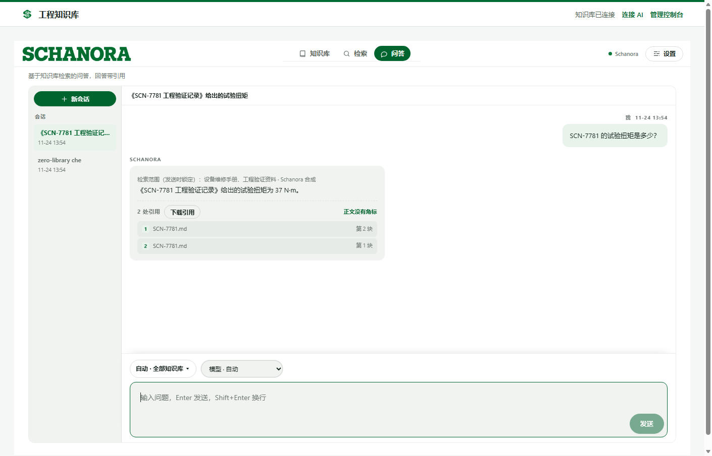
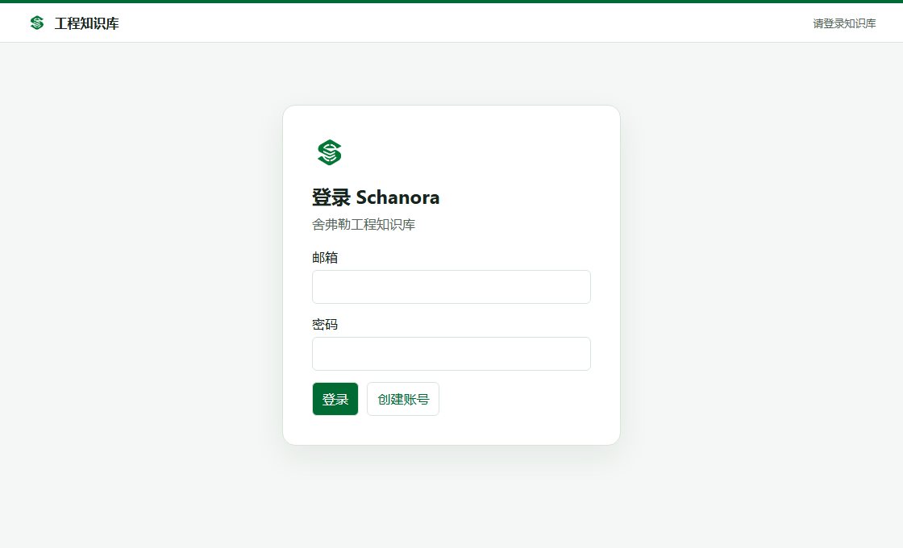

# Schanora 舍弗勒工程知识库


Schanora 是面向舍弗勒工程团队的知识库工作台。用浏览器管理作业指导书、维修手册和设计变更记录，按文件名、料号或自然语言查找资料，并从回答打开原文。也可以让 GitHub Copilot 等 AI 客户端查询同一套知识库。

[快速安装](#1-安装并打开浏览器) · [配置模型](#2-配置模型并建库) · [导入-onedrive-资料](#3-导入-onedrive-资料) · [问答与-wiki](#4-检索问答与-wiki) · [接入-copilot](#5-接入-github-copilot-与其它-ai-客户端) · [交给-ai-部署](#7-交给-ai-工具部署)



## 1 安装并打开浏览器

### Windows x64 快速安装

准备 **Node.js 24**。Git 用于克隆或更新源码。使用 ZIP 时可以省去 Git。安装器会从本仓库的 Release 下载内核运行时、核对 SHA-256 并解包。运行时固定为 WeKnora v0.9.0 Lite，包含本地 SQLite、文本检索及向量检索。首次安装需要访问 GitHub 下载文件。浏览器在同一台电脑上打开本机服务。

```powershell
git clone https://github.com/CHRISYU2233/Schanora-Republic.git
Set-Location Schanora-Republic
node --version
powershell.exe -NoProfile -File .\scripts\install-weknora.ps1
.\open-schanora.cmd
```

也可以下载 [仓库的完整 ZIP](https://github.com/CHRISYU2233/Schanora-Republic/archive/refs/heads/main.zip)，解压后进入包含 `open-schanora.cmd` 的目录。执行上面的安装和启动命令。若网络要求先手动下载，打开 [Windows x64 运行时 Release](https://github.com/CHRISYU2233/Schanora-Republic/releases/tag/weknora-lite-0.9.0-windows-x64) 获取 ZIP，再传入文件路径。

```powershell
powershell.exe -NoProfile -File .\scripts\install-weknora.ps1 -Archive "D:\Downloads\WeKnora-Lite-0.9.0-windows-x64.zip"
```

下次可以直接双击 `open-schanora.cmd`。启动成功后会打开 [本机 Schanora 工作台](http://127.0.0.1:8080/schanora/workspace.html)。用现有账号登录，首次部署并允许本地注册时可点击「创建账号」。使用期间保留启动窗口。按 Ctrl+C 停止服务。



| 场景 | 操作 |
| --- | --- |
| 测试安装 | `.\open-schanora.cmd --demo --port 18080`，启动一个独立临时实例 |
| 默认端口被占用 | `.\open-schanora.cmd --port 8088`，浏览器和 MCP 都用新端口 |
| 选择数据位置 | `.\open-schanora.cmd --root "D:\SchanoraData\weknora"`，正式运行持续使用同一路径 |
| 检查服务 | `Invoke-RestMethod http://127.0.0.1:8080/health`，预期 `status` 为 `ok` |
| 使用便携 Node | `$env:SCHANORA_NODE = "D:\Tools\node-v24-win-x64\node.exe"`，在同一终端启动 |

**默认数据目录**为 `%USERPROFILE%\Schanora\weknora-0.9.0`。更新源码后重启时复用原来的 `--root`。账号、已导入文件、索引以及模型设置随这套数据保留。Windows x64 运行时已验证。其他系统需要准备与其平台匹配的内核和官方前端，通过 `node scripts/start-weknora.mjs --runtime <运行时目录>` 启动。[固定版本源码](https://github.com/Tencent/WeKnora/tree/v0.9.0) · [Node.js 下载](https://nodejs.org/en/download)

<details>
<summary>从官方源码构建 Windows x64 运行时</summary>

固定上游提交为 `f17ee8a8da901bd658a4cb25f40b5fd41adbfdd7`。需要 Go 1.26、MinGW-w64 POSIX/UCRT、Node.js 和 npm。在独立目录执行以下命令。运行时目录要包含 `WeKnora-lite.exe`、`web/index.html`、`config/config.yaml` 和 `migrations/sqlite/`。

```powershell
git clone --branch v0.9.0 --depth 1 https://github.com/Tencent/WeKnora.git
Set-Location WeKnora
git rev-parse HEAD
go mod download github.com/mattn/go-sqlite3
$sqlite = (go mod download -json github.com/mattn/go-sqlite3 | ConvertFrom-Json).Dir
$include = New-Item -ItemType Directory -Force .schanora-include
Copy-Item (Join-Path $sqlite "sqlite3-binding.h") (Join-Path $include.FullName "sqlite3.h")
$env:CGO_ENABLED = "1"
$env:CGO_CFLAGS = '-I"' + $include.FullName.Replace("\", "/") + '"'
$env:CGO_LDFLAGS = "-lwinpthread"
$prefix = "github.com/Tencent/WeKnora/internal/handler"
go build -tags sqlite_fts5 -ldflags "-s -w -X ${prefix}.Version=0.9.0 -X ${prefix}.Edition=lite -X ${prefix}.CommitID=f17ee8a8da901bd658a4cb25f40b5fd41adbfdd7" -o WeKnora-lite.exe ./cmd/server
npm.cmd --prefix frontend ci
npm.cmd --prefix frontend run build
Copy-Item frontend/dist web -Recurse
```

回到 Schanora 根目录，用 `--runtime` 指向上述目录。若链接阶段提示 `-lrstrtmgr` 或 DuckDB 的 C++ 符号缺失，请核对 MinGW-w64 工具链版本。

</details>

## 2 配置模型并建库

打开顶栏「设置 → 模型与 API Key」，选择「添加模型」。一次配置一种用途。填写服务商提供的模型 ID、接入地址和 API Key，再点「保存并测试」。页面会分别显示保存状态和测试结果。密钥默认隐藏。编辑已有远程模型时可更新 Key 或只点「测试模型」。


| 类型 | 用途 | 填写与绑定 |
| --- | --- | --- |
| 对话模型 | 根据资料生成有引用的答案 | DeepSeek 使用官方默认 Base URL，兼容服务填实际地址。在问答输入框上方直接切换 |
| Embedding | 为文档分块和检索问题计算向量 | 填服务商提供的向量维度。建库时绑定此模型，随后启用向量检索 |
| Rerank | 给召回的候选片段重新排序 | 填服务商的重排接口，如其文档指定的完整 `/v1/rerank` 地址。在相应的问答或智能体检索配置中绑定 |

1. 在「知识库」新建文档库。推荐按业务场景命名，例如「设备维修手册」「工艺规程」「设计变更记录」。
2. 选择已测试通过的 Embedding。在库页点「索引设置」打开高级配置，检查向量检索是否开启。先用默认分块参数验证一份文档，再按资料结构调整。
3. 先验证文件能完成解析、可以查看分块。再用一条关键词和一条同义问法测试检索。最后开启 Rerank，核对最相关的章节是否排到了前面。

**变更 Embedding 的后续处理**。已有向量来自原模型。同一个库换模型或维度时，先核对高级配置及索引重建流程，重新生成受影响资料的向量后再做检索验收。对话模型和 Rerank 的切换一般无需重建文档向量。

## 3 导入 OneDrive 资料

OneDrive 保存工程源文件。Schanora 从 **OneDrive 客户端已同步到本地的副本**读取文件，在本机知识库里生成并保存索引。多台电脑独立部署时，各自从同一源建索引。要共享同一份已经生成的索引，需要使用由组织部署且账号可访问的同一实例。


### 在浏览器导入文件或文件夹

1. 在 OneDrive 桌面客户端登录公司账号，找到同步后的共享目录。右键选择「始终保留在此设备上」，等同步完成。
2. 在 Schanora 打开目标知识库的「文档」。点「导入文件夹」并选择本机 OneDrive 目录，也可以单独上传文件。
3. 等待文档状态变为「已完成」，打开详情核对文件路径、解析阶段和分块。扫描 PDF 应先确认可提取正文或具备合适的 OCR。
4. 如果配置错误、设备断开或文件暂时无法处理，先在详情中看失败原因。问题解决后点击「重新解析」，沿用该文档的记录。

### 使用脚本增量导入

适合反复处理同一个共享目录。先到「管理控制台 → 设置 → 发布与集成 → API」，为目标库创建带 `retrieve` 和 `ingest` 权限的 **知识库 API Key**，并记录实际库 ID。以下例子使用 PowerShell 7 的隐藏输入。

```powershell
$folder = "D:\OneDrive - 公司名\Engineering\Work Instructions"
$kb = "填写实际知识库ID"
$base = "http://127.0.0.1:8080"

# 预览要导入或更新的相对路径
node scripts/sync-onedrive.mjs --folder $folder --kb $kb --base $base

$env:WEKNORA_API_KEY = Read-Host "导入用 API Key" -MaskInput
try {
    node scripts/sync-onedrive.mjs --folder $folder --kb $kb --base $base --apply
    node scripts/sync-onedrive.mjs --folder $folder --kb $kb --base $base --status
} finally {
    Remove-Item Env:WEKNORA_API_KEY -ErrorAction SilentlyContinue
}
```

脚本递归读取常见办公文档和文本，跳过隐藏文件、Office 临时文件和符号链接。单文件默认上限为 50 MiB，可用 `--max-mib` 调整，仍需符合服务端的上传限制。用 SHA-256 跳过未修改的内容。同步记录默认在 `%USERPROFILE%\Schanora\onedrive-sync`，也可用 `--state` 指向源文件夹以外的本地记录。

| 输出状态 | 怎么处理 |
| --- | --- |
| `new` / `changed` | 预览发现新增或内容变化，检查范围后用 `--apply` 提交 |
| `submitted` | 服务已接收。用 `--status` 或浏览器查看是否真正解析完成 |
| `completed` | 可以检索文档并打开原文分块 |
| `failed` | 阅读浏览器里的处理错误，修复后重新解析 |
| `source-missing` | 云端或本机源文件已移动或删除，由资料管理员核对库内对应文档 |

变更文件会作为新版提交，脚本返回 `previousIds`。新版通过检索和引用验收后，由资料管理员归档旧版，避免答案同时命中不同修订。OneDrive 适合共享源文件或停止服务后生成的备份。运行中的 SQLite、文件索引和密钥配置保存在本机数据目录。

## 4 检索问答与 Wiki

| 任务 | 入口与操作 |
| --- | --- |
| 查找精确料号、标准号和段落 | 「检索」选择范围，输入关键词，打开命中片段 |
| 根据资料提问 | 「问答」直接输入后按 Enter。默认检索当前账号可用的全部库，点击资料范围可缩小。Shift+Enter 换行 |
| 切换生成模型 | 输入框上方「模型 · 自动」下拉。仅显示已配置的对话模型 |
| 使用专业智能体 | 展开资料范围后打开「智能体」。智能体使用自身的模型及工具配置 |
| 复核与分享回答 | 点击引用展开原文，「下载引用」导出 Markdown，包含回答、文档、原文片段及可用标识 |
| 浏览知识库的 Wiki | 进入目标库的「Wiki」。先在库配置启用 Wiki 索引和生成模型，再处理资料生成页面 |

可用提问示例。

> 查找设备 SCN-7781 的试验扭矩。请给出文件名称、修订版本和原文引用。有冲突时列出各版本差异。

内置会话提示词把助手身份设为 **Schanora，面向舍弗勒工程团队的知识库助手**。对话模型是设置中添加的服务商模型。已有会话消息保留。自定义智能体可在管理控制台独立编辑身份提示词。

## 5 接入 GitHub Copilot 与其它 AI 客户端

### 创建并验证 MCP 端点

1. 打开工作台顶栏「连接 AI」。在 MCP 管理页创建一个端点，选定可用的知识库。
2. 建议给日常工程查询启用 `list_knowledge_bases`、`search_knowledge`、`grep_chunks` 和 `read_document`。Wiki 可按需开放。需要从 AI 客户端调用 Schanora 内核生成完整回答时，再启用 `ask`，并为端点绑定默认智能体。
3. 保存端点，复制完整 URL 和创建时显示的 MCP Token。URL 形如 `http://127.0.0.1:8080/mcp/实际端点ID`。
4. 在同一台电脑运行以下验证。脚本会完成握手、读取工具并实际调用列库工具。

```powershell
$mcpUrl = "http://127.0.0.1:8080/mcp/填写实际端点ID"
$env:SCHANORA_MCP_TOKEN = Read-Host "Schanora MCP Token" -MaskInput
node scripts/check-mcp.mjs --url $mcpUrl
```

输出 `MCP list_knowledge_bases is callable.` 表示该端点已通过协议和认证验证。**模型 API Key** 填在模型设置，**知识库 API Key** 用于导入脚本，**MCP Token** 用于 AI 客户端的 `Authorization: Bearer …`。轮换 Token 后同步更新客户端凭据。

### GitHub Copilot CLI 与 VS Code

使用 [Copilot 配置模板](integrations/copilot-cli.mcp.example.json)，将 `mcpServers.schanora` 合并到个人 `~/.copilot/mcp-config.json`。若设置了 `COPILOT_HOME`，用该目录。保留原有 MCP 条目，把模板 URL 替换为实际地址，JSON 中保留 `${SCHANORA_MCP_TOKEN}` 作为环境变量引用。保存后从设置过该变量的终端启动 `copilot`，运行 `/mcp show schanora`。

在 VS Code 使用 Copilot 本地会话时，可复用 Copilot 原生配置。先设置环境变量并启动 VS Code，在 `Chat: Open Customizations` 的 MCP Servers 中检查 Schanora。若编辑器仍使用旧的 Local 模式，可从 [编辑器管理配置模板](integrations/vscode.mcp.example.json) 合并到个人 MCP 设置，按提示填写 URL 与 Token。 [Copilot CLI 官方配置](https://docs.github.com/en/copilot/how-tos/copilot-cli/customize-copilot/add-mcp-servers) · [VS Code 官方配置](https://code.visualstudio.com/docs/agents/reference/mcp-configuration)

### 其它 AI 客户端

| 客户端 | 设置方式 |
| --- | --- |
| Cursor 或支持自定义 HTTP MCP 的桌面应用 | 选择 **Streamable HTTP**，填 URL 和 `Authorization` 请求头。可合并 [通用 JSON 模板](integrations/http.mcp.example.json) 到个人配置 |
| Claude Code | 在「连接 AI」的端点页复制对应的 Claude Code 命令，在本机以个人范围配置 |
| 仅支持 stdio 的客户端 | 使用端点页提供的兼容桥接配置，先通过独立脚本验证原生 HTTP |
| GitHub.com Copilot 云代理 | 配置由组织提供且云代理可访问的 HTTPS MCP。仓库设置中限制工具范围，凭据存放在 GitHub Agents secrets |

本机 `127.0.0.1` 面向在同一台电脑执行的客户端。云端会话和远程开发容器需要能从各自的执行环境访问端点。 [GitHub 云代理 MCP 文档](https://docs.github.com/en/copilot/how-tos/copilot-on-github/customize-copilot/configure-mcp-servers)

验收时让客户端完成一次真实的「列库 → 检索 → 读取原文」。例如要求它到工程资料库找 `SCN-7781`，给出命中的文档和引用，再和浏览器里的原文对照。

## 6 更新备份与排查

### 更新和备份

- 使用 Git 的部署在仓库目录执行 `git pull --ff-only`，然后用原启动参数重启。使用 ZIP 的部署可以将新版解压到单独目录，安装运行时，启动时指向原数据目录。
- 备份前停止服务。完整备份数据目录，包含 SQLite、文件目录和 `.weknora-secrets.json`。恢复时解压到专用目录，用 `--root` 指向它。用原有账号登录后抽查一条文档和一个模型。
- 各电脑独立部署时保留各自的数据与同步记录。OneDrive 改变云端源资料后，执行 `--apply` 将变化提交到对应实例。

### 常见问题

| 现象 | 检查方式 |
| --- | --- |
| 运行时安装失败 | 检查 Windows 架构、下载权限或安全策略、ZIP 校验结果和 `runtime` 目录状态。可使用 `-Archive` 从正确的本地 ZIP 安装 |
| 浏览器打不开或仍显示旧版 | 核对启动窗口、端口和 `/health`。从已更新的仓库重启服务，再刷新浏览器 |
| 保存模型成功但测试失败 | 核对模型 ID、API Key、Base URL、模型用途和出站访问。Embedding 还需核对输出维度 |
| OneDrive 文件没有进入库 | 确认文件已实际同步到本机，检查 `--status`、权限和支持的解析格式 |
| 文件已完成但找不到 | 检查实际检索范围、Embedding、向量索引和分块。先用文件里的独特术语检索 |
| MCP 返回 401 或 403 | 确认 MCP Token、端点启用状态、库范围和工具权限。用 `scripts/check-mcp.mjs` 在宿主之外排查 |
| Copilot 的工具列表为空 | 核对配置文件所在宿主、是否继承 `SCHANORA_MCP_TOKEN`、工作区信任及企业 MCP 策略 |

<details>
<summary>其它兼容入口和旧版资料迁移</summary>

DeepSeek Harness 可用 `node scripts/install-dsh.mjs --profile desktop` 预检，再加 `--apply` 写入对应 profile。按提示安装依赖。在进程中配置 `WEKNORA_BASE_URL` 和对应知识库 API Key，从侧栏打开 Schanora，或在会话中调用 `weknora_search`。原 Node.js 版的备份及旧版迁移参见[交接记录](docs/handoff/CODEX-HANDOFF.md)。

</details>

## 7 交给 AI 工具部署

将仓库链接和下面的任务一并交给能运行本机终端的 AI 工具。登录及凭据步骤在对应的本机界面完成。

```text
请部署 CHRISYU2233/Schanora-Republic 的 main，严格依据仓库 README。
1. 核对 Windows 架构、Node.js 版本、监听端口和旧数据目录。保留已有部署的数据。
2. 在一个干净的 Windows x64 checkout 安装发布的运行时。先用 --demo 启动独立端口，
   检查 /health 和浏览器登录页。确认正常后按原来的端口和数据目录启动正式服务。
3. 如需 OneDrive，从我实际同步到本机的文件夹读取。配置并测试对话、Embedding、Rerank。
   为测试库绑定 Embedding、启用向量检索。用合成文件依次验证预览、上传、解析、分块和检索。
4. 如需 Copilot 或其它 AI 客户端，在「连接 AI」创建指定库的 MCP 端点并校验。
   按目标宿主合并模板，保留已有配置。请我在本机提供凭据，勿把值写进仓库或报告。
   在宿主里验证列库、检索和读原文三个调用。
5. 回报实际浏览器地址、数据目录、所用版本、各项测试结果以及尚需我完成的操作。
```

### 维护者校验

```powershell
node scripts/build-client.mjs
node --test test/*.test.mjs
node scripts/check-bundle.mjs
node scripts/check-design.mjs
```

Windows 验证覆盖运行时解包、浏览器登录、模型切换、自动范围、OneDrive 同步目录入库及去重、MCP 认证与调用。示例工程资料及模型响应为测试数据。
