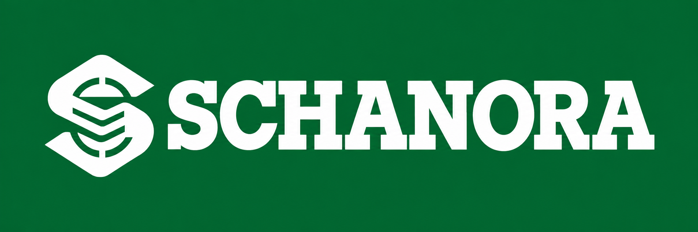

# Schanora



**Schanora 是面向工程资料的本地知识库。** 浏览器默认打开 Schanora 工程工作区，通过同源接口连接官方 **WeKnora v0.9.0 Lite**。DeepSeek Harness（DSH）的 Schanora 侧栏打开同一个工作区，会话使用 WeKnora 官方工具。下方保留了原 Node.js 版的数据导出指南。

## WeKnora v0.9.0 接入

运行时固定为官方 [v0.9.0](https://github.com/Tencent/WeKnora/releases/tag/v0.9.0)，提交 `f17ee8a8da901bd658a4cb25f40b5fd41adbfdd7`。Lite 使用本机 SQLite、FTS5 和 sqlite-vec。浏览器直接连接 WeKnora，DSH 也调用同一实例的 API。文档处理、混合检索、引用和 Wiki 由 WeKnora 实现。Lite 支持的解析引擎与协作功能见[官方版本说明](https://github.com/Tencent/WeKnora/blob/v0.9.0/docs/LITE.md)。

### 准备运行时

GitHub 的 v0.9.0 Release 页面目前只提供源码。Windows 可在独立目录从 v0.9.0 源码构建服务和前端。构建需要 Go 1.26、支持 64 位的 MinGW-w64 工具链、Node.js 和 npm，以及构建依赖的网络。命令从 WeKnora 源码根目录执行。下面以 PowerShell 为例。

```powershell
go mod download github.com/mattn/go-sqlite3
$sqlite = (go mod download -json github.com/mattn/go-sqlite3 | ConvertFrom-Json).Dir
$include = New-Item -ItemType Directory -Force .schanora-include
Copy-Item (Join-Path $sqlite 'sqlite3-binding.h') (Join-Path $include.FullName 'sqlite3.h')
$env:CGO_ENABLED = '1'
$env:CGO_CFLAGS = '-I"' + $include.FullName.Replace('\', '/') + '"'
$env:CGO_LDFLAGS = '-lwinpthread'
$prefix = 'github.com/Tencent/WeKnora/internal/handler'
go build -tags sqlite_fts5 -ldflags "-s -w -X ${prefix}.Version=0.9.0 -X ${prefix}.Edition=lite -X ${prefix}.CommitID=f17ee8a8da901bd658a4cb25f40b5fd41adbfdd7" -o WeKnora-lite.exe ./cmd/server
npm.cmd --prefix frontend ci
npm.cmd --prefix frontend run build
Copy-Item frontend/dist web -Recurse
```

如链接时提示找不到 `-lrstrtmgr` 或 DuckDB 的 C++ 符号，使用新版 MinGW-w64 POSIX/UCRT 工具链。完成后，运行时目录应包含 `WeKnora-lite.exe`、`web/index.html`、`config/config.yaml` 与 `migrations/sqlite/`。

### 启动工作台和配置模型

把准备好的运行时放在项目的 `runtime/weknora-0.9.0/` 目录。Windows 从 Schanora 根目录运行 `.\start-web.cmd`，有 npm 时也可运行 `npm run web`。运行时在其他位置时可以指定绝对路径。验收时加 `--demo` 使用系统临时数据目录。

```powershell
node scripts/start-weknora.mjs --runtime 'D:\Work\WeKnora-0.9.0' --demo
```

打开打印的 Schanora 工作区地址，默认是 `http://127.0.0.1:8080/schanora/workspace.html`。使用页面的登录入口注册或登录 WeKnora 账号，然后返回 Schanora 刷新。「WeKnora 管理」进入官方界面，可管理账号、数据源和 Wiki 高级设置。

1. 打开 Schanora 顶栏的「设置 → 模型与 API Key」，在「模型配置」里选择「添加模型」。选好用途（对话、Embedding 或 Rerank）和服务商，填写服务商提供的模型 ID。
2. 用 DeepSeek 官方对话接口时，在「服务商 API Key」粘贴 DeepSeek 密钥，Base URL 留空时使用官方地址。使用兼容接入点时，填写服务商给出的 Base URL 和所需密钥。Embedding 还需要填写模型的输出维度。选择本机 Ollama 时，填写已拉取的模型名，连接使用 WeKnora 服务的 Ollama 配置。
3. 点「保存模型」，再点「测试模型」。测试使用固定示例文本调用所保存的模型。更换密钥时，从「模型配置」选已有的远程模型，在「新的服务商 API Key」输入新密钥并点「更新 API Key」。密钥由 WeKnora 保存。添加模型、换密钥和测试需要 WeKnora 管理员权限。
4. 新建知识库时选择对应的 Embedding 模型。浏览器「问答」默认使用 WeKnora 选定的对话模型。需要指定模型时，点击输入框上方的资料范围按钮，再展开「模型与智能体」。智能体的模型和 Rerank 仍通过 WeKnora 智能体设置绑定。

建库后可以上传文档、查看状态与分块，并指定库检索和提问。库内的 Wiki 标签读取 WeKnora 已有页面。生成式 Wiki 需要给目标库开启 Wiki 索引并配置生成模型。日常使用时可直接使用默认数据目录，也可用 `--root 'D:\SchanoraData\weknora'` 指定一个专用目录。

原版的网页采集、浏览器桥接和批量导入使用独立接口。WeKnora 模式的 Schanora 导入菜单提供文件上传。可从「WeKnora 管理」使用官方原生的导入和连接器功能。

### 在工作台提问

1. 打开「问答」，输入问题后按 Enter。默认检索当前账号可用的全部知识库。没有知识库时，直接调用对话模型。
2. 需要缩小范围时，点击输入框上方显示当前范围的按钮，点选一个或多个知识库。浏览器会记住这组选择。点「自动」恢复全部可用库，点「直接问模型」可切换到模型问答。
3. 使用智能体时，从同一个按钮进入「模型与智能体」。可以选用已配置的智能体，也可以点击「管理智能体」去 WeKnora 配置对话模型、知识检索和工具。启用了知识检索（`search_knowledge`）的自定义智能体需要绑定 Rerank 重排模型。选择「自动」时，智能体使用其在 WeKnora 中配置的资料范围。
4. 智能体回答会流式显示，同时列出本轮调用的工具和返回的知识库引用。点击「停止」会向 WeKnora 请求停止本轮生成。遇到需要确认、授权或补充输入的情况，点击回答下方的「打开 WeKnora 会话」继续，完成后刷新 Schanora 查看最新记录。

例如，可以在「设备维修手册」和「工程变更」两个库中选定范围，再请智能体核对某型号设备的保养周期，列出处并标注资料版本。工具和模型由 WeKnora 管理，模型能否完成多轮工具调用取决于它所支持的能力。

### 在 DSH 会话引用同一知识库

使用单独的 DSH profile 先验收。将下例中的 `desktop` 改为要配置的 profile。第一步打印预检结果，第二步写入依赖并自动备份该 profile 的 `package.json`。

```powershell
node scripts/install-dsh.mjs --profile desktop
node scripts/install-dsh.mjs --profile desktop --apply
```

按脚本提示在该 profile 目录执行 `pnpm install`。在 WeKnora 界面为 DSH 创建可访问目标库的 API key，启用检索权限，调用问答工具时另需对话权限。给 DSH 启动进程设置 `WEKNORA_BASE_URL` 和 `WEKNORA_API_KEY`，地址填写同一个本机服务，如 `http://127.0.0.1:8080`，密钥通过当前进程的环境或 DSH 的私有配置提供。在 DSH 的 Schanora 侧栏点击「打开 Schanora 工作区」，窗口会打开浏览器的完整工作区。在任意会话用 `weknora_list_knowledge_bases` 查库 ID，把选择的 ID 作为 `knowledge_base_ids` 传给 `weknora_search` 或 `weknora_ask`，可用 `weknora_read_document` 回查命中的 `knowledge_id`。[官方 DSH 插件文档](https://github.com/Tencent/WeKnora/blob/v0.9.0/packages/dsh-weknora/README.md)

要从 DSH 调用智能体，先在 Schanora「问答」选中智能体并点「复制智能体 ID」。在 DSH 会话中指定调用 `weknora_ask`，把复制的值传给 `agent_id`，并传入目标库的 `knowledge_base_ids`。如需为某个 DSH profile 设定默认智能体，将该 ID 写入其启动环境的 `WEKNORA_AGENT_ID`。单次调用传入的 `agent_id` 优先。

### 迁移现有资料

先用原版 Schanora 导出备份，保留原始文件，再将文档上传到新建的 WeKnora 知识库重新建索引。两个版本使用各自的存储格式和文档 ID。OneDrive 适合分发源资料。各电脑的运行中 SQLite 应放在各自的本地目录，避免文件同步过程中出现不一致状态。需要备份此实例时，先停止服务，再将数据目录整体复制到私有备份位置，其中的 `.weknora-secrets.json` 用于解密该实例的模型凭据等数据。部署时通过环境指定的密钥也需跟随实例保存。

### 本机验收

Windows 运行了从官方标签编译的 WeKnora Lite，登录后经 `/api/v1/system/info` 核对版本和提交。向原生上传接口提交合成工程文档，核对处理状态、分块与指定库检索。用独立的 DSH 配置启动真实会话，验证官方工具拿到同一个 WeKnora 文档 ID 和原文片段，再通过官方 `ask` 客户端核对问答引用包含该 ID。验收用本机固定响应的模型替身覆盖接口链路，企业模型的生成效果和 Wiki 自动生成需要接入实际模型后复验。

智能体验收使用同样隔离的资料目录和测试模型。在浏览器选择自定义智能体和知识库，核对模型调用检索工具、回答流式显示、引用展开原文、刷新后恢复引用，以及停止请求。再在真实 DSH 会话中向 `weknora_ask` 显式传入同一智能体 ID，核对返回内容引用同一分块。

## 原版 Node.js 指南

[快速开始](#快速开始) · [日常使用](#日常使用) · [数据目录与-onedrive](#数据目录与-onedrive) · [备份与迁移](#备份与迁移) · [交给-ai-工具配置](#交给-ai-工具配置) · [常见问题](#常见问题)

## 功能简介

| 功能 | 适合做什么 |
| --- | --- |
| 知识库与文档 | 按部门、项目或资料性质建库，上传文件，查看处理状态、抽取内容和文档分块 |
| 检索与引用 | 查找图号、料号、标准号和技术术语，限定查询范围并查看命中的原文片段 |
| 工程问答 | 针对已选资料提问，沿引用查看证据。安装本机模型后可使用生成式回答 |
| Wiki 浏览 | 从已处理的文档中浏览库索引、文档页与主题摘录 |
| 采集与批量导入 | 将网页选段、Markdown 笔记等已获取的正文保存到指定知识库 |
| 数据备份与迁移 | 通过浏览器导出资料和会话，在另一台电脑校验并恢复 |
| OneDrive 共享文件夹 | 将本机数据目录设为已同步的共享文件夹，让团队分发同一份资料 |

**基础模式可离线运行。** Node.js 内核在本机完成文本抽取、分块、关键词检索和带出处的摘录。语义排序及生成式问答需要可用的本机 Ollama 模型。DSH 的主对话和浏览器自动采集依赖相应宿主接口或扩展。

## 快速开始

### 1. 准备环境

- **浏览器版**需要 **Node.js 24**（推荐）和 Chrome、Edge 等现代浏览器。启动、导入样例和验收都可以直接使用 Node.js。浏览器所需的前端文件随项目提供，无需 `npm install`。
- **DSH 版**需要已经运行过的 DeepSeek Harness，以及该环境用于管理插件依赖的 pnpm。
- 推荐首次部署时将 [main 的完整 ZIP](https://github.com/CHRISYU2233/Schanora-Republic/archive/refs/heads/main.zip) 解压到一个新建目录。也可以用 Git 克隆。已有工作区如果有未提交改动，保留它并另建副本即可继续部署。

```bash
git clone https://github.com/CHRISYU2233/Schanora-Republic.git
cd Schanora-Republic
node --version
```

在仓库根目录确认能看到 `package.json`、`DESIGN.md`、`start-web.cmd`、`scripts/` 和 `web/`。下载 ZIP 后如果外层目录还有一层 `Schanora-Republic-main`，进入内层再执行命令。

### 2. Windows 找不到 Node 或 npm 时

在 PowerShell 运行 `node --version`。只要 Node 可运行，就可继续下一步。推荐使用 [Node.js 官网](https://nodejs.org/en/download)提供的 Node.js 24，安装后关闭并重新打开终端再检查。

也可以使用企业允许的便携版。从 [Node.js 24 Windows 官方下载目录](https://nodejs.org/dist/latest-v24.x/)选择与电脑匹配的 ZIP（x64 或 ARM64），将其解压至本机目录。在当前 PowerShell 为启动器指定实际路径即可，无需修改系统 PATH。

```powershell
$env:SCHANORA_NODE = 'C:\Tools\node-v24-win-x64\node.exe' # 改成实际解压路径
& $env:SCHANORA_NODE --version
```

如企业电脑限制运行或安装 Node.js，请使用 IT 提供的可用运行时。拿到可执行文件后可直接使用上面的路径方式。

### 3. 一条命令启动演示

在项目根目录使用 Node 启动原版演示。

```bash
node scripts/local-server.mjs --demo --port 0
```

启动器会在系统临时目录里新建一个 `schanora-demo-*` 数据目录，并自动导入三份虚构示例文档。演示模式使用独立目录，即使环境中已设置 `SCHANORA_ROOT` 也可以运行。每次启动产生一份新的演示数据，退出后可以保留或清理日志所示的演示目录。 `--port 0` 让系统挑选可用端口。

终端显示「本地内核已启动」后，打开「浏览器」一行给出的**实际地址**。保持终端运行，退出时按 Ctrl+C。可在另一个 PowerShell 中检查服务，用实际端口替换示例值：

```powershell
$base = 'http://127.0.0.1:4326' # 改成「浏览器」行的实际地址
(Invoke-RestMethod "$base/health").data
```

确认 `runtime` 为 `web`，`storeRoot` 指向本次新建的 `schanora-demo-*` 目录。打开「知识库」确认出现「工程标准库」。在「检索」选中该库并搜索 `GB/T 3452`，展开命中查看出处。到「问答」选库后开启「深度研究」，询问「O 形圈的压缩率一般取多少？」。有本机对话模型时可生成回答，其余情况下显示带出处的原文摘录。样例仅用于演示流程。

### 4. 启动日常使用的浏览器版

各平台均可直接运行：

```bash
node scripts/local-server.mjs --web
```

通常使用 `http://127.0.0.1:4317/`。初次打开或更换数据目录时，参考[数据目录与 OneDrive](#数据目录与-onedrive)，通过 `--root` 指定资料目录并在页面设置里核对实际路径。若已配置 npm，`npm run web:legacy` 也可启动原版。

### 5. 安装 DSH 插件

在项目根目录执行预检。将 `desktop` 替换成实际使用的 DSH profile 名称。

```bash
node scripts/install-dsh.mjs --legacy --profile desktop
```

确认显示的 profile 和本地插件路径后执行配置。

```bash
node scripts/install-dsh.mjs --legacy --profile desktop --apply
```

安装器会备份并更新指定 profile 的 `package.json`。按输出进入该 profile 目录，使用 DSH 随附的 pnpm 或已配置的 `corepack pnpm install` 安装依赖。完全退出并重新启动 DSH，在左侧栏打开「知识库」。进入「设置」查看内核连接状态和实际数据目录。若要回退，恢复安装器打印的备份文件，再安装一次 profile 依赖并重启 DSH。

## 日常使用

### 创建和整理知识库

1. 在「知识库」点击「新建知识库」，填写名称与说明。例如为「装配工艺」和「试验报告」分别建库。
2. 基础关键词检索可使用默认配置。需要向量排序时，在创建时选择已检测到的本机 Embedding 模型。
3. 打开目标库，通过「导入资料 → 上传文件」添加资料。处理结束后，在「文档」查看结果。
4. 打开文档详情，查看处理状态、失败原因和分块。确认能看到原文段落后再问答。
5. 可为文档添加标签并按标签筛选。标签保存在当前浏览器，换浏览器或换电脑时使用文档列表的「导出标签」和「导入标签」。

| 资料类型 | 导入方式 |
| --- | --- |
| Markdown、TXT、CSV、TSV、JSON、YAML、HTML 等 | 直接上传文本。中文文本建议使用 UTF-8 |
| DOCX | 本机抽取正文。关键参数可在分块中核对 |
| 文本型 PDF | 尝试抽取文字。检查表头、单位与特殊字符是否保留 |
| 扫描型 PDF、图片 | 先用 OCR 得到可编辑文字，再上传文本或带文本层的 PDF |
| Excel、CAD 及其他工程二进制文件 | 将需检索的内容导出为 CSV、文本或带文本层的 PDF。保留原件供核查 |

### 检索资料

1. 打开「检索」，选择本次要查的知识库。
2. 输入图号、标准号或工艺关键词。可组合对象与条件，例如「M10 装配 扭矩」。
3. 展开命中，核对文档标题、相关段落和分块。找不到结果时，可缩短问题、换用原文常用术语，或检查资料是否完成处理。

基础检索采用 **BM25**。本机 Embedding 可对关键词召回的候选进行语义重排。因此查工程编号和专有术语时，保留编号原文、单位和具体条件通常更有效。结果分数用于排序，实际设计参数以出处为依据。

### 问答与查证

1. 打开「问答」，新建会话或从列表打开已有会话。
2. 选择知识库范围，再输入问题。例如「试验报告中高温工况的转速和温度分别是多少？」。
3. **普通模式**列出证据。要在 Schanora 面板内生成或保存完整的一轮问答，开启**深度研究**后发送。
4. 点击引用角标或打开引用列表，回到来源片段，核对版本、单位和适用条件。若证据不足，补充相应资料或缩小问题范围。

深度研究在有本机对话模型时生成答案。没有模型时，内核保存问答记录并提供带出处的原文摘录。历史会话保存在数据目录的 `sessions/` 中。

### 采集笔记与网页选段

1. 进入对应知识库，在「导入资料 → 网页与笔记」中选择「Markdown 笔记」或「网页选段」。
2. 填写标题、正文和目标库。已有来源网址时可一并记录。
3. 确认内容后点击「提交入库」，回到文档列表核对处理结果。
4. 有多份 Markdown 笔记时，可使用「批量导入」，逐项查看提交与失败结果。

独立本地版的常用采集方式是粘贴正文或上传已下载文件。「浏览器采集」是扩展接入入口，自动读取页面及网站下载取决于当前环境的浏览器桥接能力。

### 浏览 Wiki

在知识库内切换到「Wiki」。本地内核根据已经处理的文档组织索引页、文档页和主题页。打开主题页可查看原文摘录和来源。刚建立的空库会先显示索引，导入文档后刷新即可查看内容。当前 Wiki 以资料浏览和出处追溯为主。

## 数据目录与 OneDrive

### 使用本机目录

新安装默认使用用户目录下的 `Schanora` 文件夹。已有旧版 OneDrive 数据目录且含有 `schanora.json` 时，内核可继续识别。浏览器版可通过 `--root` 指定数据目录，也可在启动环境中设置 `SCHANORA_ROOT`。

```powershell
node scripts/local-server.mjs --web --root "D:\SchanoraData" --port 4317
```

在 macOS 或 Linux 终端中可指定对应的本机目录。

```bash
node scripts/local-server.mjs --web --root "$HOME/SchanoraData" --port 4317
```

DSH 插件读取宿主进程的 `SCHANORA_ROOT`，也可通过 `schanora-client` 的 `root` 配置指定目录。改动后重启宿主，打开插件「设置」核对实际路径。

### 使用 OneDrive 共享文件夹

1. 让每台电脑同步同一个团队共享文件夹。在 Windows 的 OneDrive 文件夹选项中，将团队资料目录设为「始终保留在此设备上」。
2. 将各台电脑的 Schanora 指向该文件夹在本机的绝对路径。每台电脑盘符和目录名可以不同。
3. 由一台机器负责编写和更新资料，其他成员等待 OneDrive 同步完成后刷新查看。

```powershell
node scripts/local-server.mjs --web --root "D:\OneDrive - 公司\工程共享\Schanora" --port 4317
```

| 数据项 | 位置与迁移方式 |
| --- | --- |
| 知识库清单 | `schanora.json` |
| 已入库文档和元数据 | `kbs/` 中的 Markdown 和 JSON |
| 问答历史 | `sessions/` |
| 采集和任务记录 | `clips/` 与 `jobs/` |
| 关键词索引 | 各机本地重建 |
| 文档标签 | 当前浏览器，通过标签导入导出功能迁移 |

**同一个可写数据目录建议只由一个 Schanora 实例使用。** 浏览器版和 DSH 可错开运行，或者各自指定数据目录。当前版本没有跨机器写锁。深度问答也会写入会话文件。如果同事需要用共享资料问答，同时保留个人会话，可以先将共享库的备份恢复为个人副本，再从副本启动。普通文件复制到共享目录后，还需要通过上传流程纳入知识库。

## 配置本机模型

基础检索随服务启动，资料保存在本地文件中，日常启动无需配置 WeKnora、网关地址或生产数据库。需要生成式回答或语义重排时，先安装并启动本机 Ollama，再准备对应的对话模型与 Embedding 模型。Schanora 默认探测 `http://127.0.0.1:11434`，支持通过 `OLLAMA_HOST` 指定其他本机端口。启动时读取环境变量。

```powershell
$env:OLLAMA_HOST = "http://127.0.0.1:11434"
node scripts/local-server.mjs --web
```

打开实际服务端口的诊断接口。

```powershell
$base = "http://127.0.0.1:4317"
(Invoke-RestMethod "$base/health").data
(Invoke-RestMethod "$base/capabilities").data.features
```

`health` 提供运行模式、版本和数据目录。浏览器版的 `runtime` 为 `web`，DSH 插件内核为 `plugin`。`capabilities` 中的 `chat` 和 `search.vector` 表示本机内核探测到的模型能力。向量排序还需要该知识库配置 Embedding 模型。模型不可用时可继续使用关键词检索和原文摘录。

## 备份与迁移

### 下载备份

浏览器版右上角提供「下载数据备份」。备份包含已经落盘的知识库清单、正文、元数据、会话及采集记录，每个文件都带 SHA-256 校验值。备份前暂停对资料库的写入，可以避免不同的文件读到不同时间点的数据。当前下载备份适用于不超过 64 MB 的数据内容，较大的库可在停止写入后复制整个数据目录。

服务关闭时，也可以用命令导出。

```powershell
node scripts/backup-local.mjs export "D:\SchanoraData" "D:\schanora-backup.json"
```

### 在另一台电脑恢复

1. 将备份文件和 Schanora 安装包复制到目标电脑。
2. 校验备份，再恢复到一个尚不存在的新目录。该目录的父目录需已存在。
3. 启动 Schanora，指定恢复路径。核对库、文档、问答和引用。

```powershell
node scripts/backup-local.mjs verify "D:\schanora-backup.json"
node scripts/backup-local.mjs restore "D:\schanora-backup.json" "D:\SchanoraRestored"
node scripts/local-server.mjs --web --root "D:\SchanoraRestored"
```

恢复前会核对文件路径、格式和内容校验值。现有数据目录可以继续保留。浏览器标签和未入库的原始工程文件需单独迁移。

## 交给 AI 工具配置

可将下面这段话连同本 README 交给 Codex、WorkBuddy 或其他能运行命令的开发工具。

> 请按这份 README 在本机验收原版 Schanora，以便导出现有资料。先在独立目录检查 Node，运行 `node scripts/local-server.mjs --demo --port 0`。读取实际地址，通过 `/health` 核对 `runtime=web` 和演示数据目录。检查样例知识库、分块、检索、带出处的问答，以及备份校验和恢复。分别报告源码准备、服务启动和功能验收结果。

### 验收命令

浏览器初次启动可以直接使用仓库自带的构建产物。若要验收源码，在独立副本的项目根目录运行以下命令。如果 Node 未加入 PATH，在当前 PowerShell 设置 `SCHANORA_NODE`，将每条命令开头的 `node` 改为 `& $env:SCHANORA_NODE`。

```bash
node scripts/build-client.mjs
node --test test/*.test.mjs
node scripts/check-bundle.mjs
node scripts/check-design.mjs
```

如需运行浏览器验收，保持演示服务运行，在第二个终端进入同一项目根目录，填入启动日志中的实际地址。验收脚本会写入测试资料与问答记录，请使用演示实例。

```bash
node scripts/verify-local.mjs http://127.0.0.1:4326/
```

脚本自动查找常见路径下的 Chrome 或 Edge。其他安装位置可以通过 `CHROME_PATH` 指定，例如 Windows 的 `$env:CHROME_PATH = 'C:\实际安装目录\msedge.exe'`。如果 Node 未加入 PATH，在第二个终端设置 `SCHANORA_NODE` 后将命令开头的 `node` 改为 `& $env:SCHANORA_NODE`。浏览器验收以「通过 8/8、失败 0、缺项 0」为完成标准。最后按[备份与迁移](#备份与迁移)校验演示库备份并恢复到一个新目录，检查恢复后的资料能被检索。

v0.7.0 的已记录验证包括 **68 项 Node 测试**、**8 项浏览器验收**、干净解压后启动、备份恢复，以及 DSH 0.2.2-rc.3 的独立 profile 插件加载。更多细节见[发布验收记录](docs/handoff/CODEX-HANDOFF.md)。

## 常见问题

| 现象 | 建议检查 |
| --- | --- |
| 找不到 `node` | 安装 Node.js 24 后重开终端，或用 `SCHANORA_NODE` 指定已有 `node.exe` 的绝对路径 |
| 找不到 `npm` 或 PowerShell 拒绝执行 `npm.ps1` | 直接用 Node 启动。需要调用已安装的 Windows npm 时，可用 `npm.cmd` |
| 旧工作区有未提交改动 | 将 main 克隆或解压到另一个目录，从新副本部署 |
| 缺少 `package.json`、`start-web.cmd` 或 `DESIGN.md` | 确认已进入项目根目录。如是旧包，重新下载 [main 的完整 ZIP](https://github.com/CHRISYU2233/Schanora-Republic/archive/refs/heads/main.zip) |
| 无法确认部署是否完成 | 先核对 `/health` 的实际模式和数据目录，再验证浏览器样例。仅下载或解压源码表示准备完成 |
| 需要联调外部 WeKnora | 仓库提供内置本地内核。外部 WeKnora 联调另需已部署的服务与适配配置，可在本地部署验收后单独进行 |
| 浏览器打不开 | 保持 Node 启动终端运行，重新复制「浏览器」行的完整地址 |
| 端口和文档示例不一样 | 端口冲突后可能切到后续端口，以实际启动日志为准 |
| 显示空库或旧库 | 检查「设置」和 `/health` 的 `storeRoot`，确认是预期的路径 |
| 选库后仍无检索结果 | 查看文件是否处理完成，先用标题、料号或文档里的关键词试查 |
| PDF 无法分块 | 扫描件或部分特殊编码 PDF 可能无法抽出可用文本，先转换为带文本层的 PDF 或文本 |
| 原版 Node.js 问答只返回证据或原文摘录 | 检查是否开启深度研究、本机 Ollama 是否有可用对话模型 |
| WeKnora 工作台生成失败 | 在「设置 → 模型与 API Key」测试对话模型，再从资料范围按钮进入「模型与智能体」，选中该模型重试 |
| OneDrive 有文件但列表不更新 | 等待本机同步，核对资料目录后刷新。新增普通文件需要上传入库 |
| DSH 里找不到「知识库」 | 确认安装到正确 profile，依赖已更新，然后完整重启 DSH |
| 备份恢复时提示目标已存在 | 改用一个尚不存在的新目录，确保其父目录已创建 |
| 在 GitHub 页面看到了代码，如何使用 | 克隆或解压项目，按快速开始启动本机 Node 服务 |

## 目录与打包

```text
web/                         独立浏览器入口
start-web.cmd                Windows 浏览器启动器
plugins/schanora/client/     DSH 插件 Host、前端与本地内核
preview/                     开发预览与演示验收
scripts/                     启动、构建、测试、备份和插件配置
test/                        本地内核与 UI 逻辑回归测试
docs/                        接口文档、交接与验收记录
```

修改 `plugins/schanora/client/src/ui.js` 后通过构建脚本生成 `client.js`。发布前可执行下列命令，生成 `dist/Schanora-frontend/` 交付目录。

```bash
npm run build
npm run pack
```

只有 Node 时使用 `node scripts/build-client.mjs` 和 `node scripts/pack.mjs`。

GitHub 仓库用于发布代码、手册和交付 ZIP。完整浏览器功能由用户本机 Node 服务提供。团队知识库和数据备份通过本机目录或团队共享位置管理。

[MIT 许可证](LICENSE)
